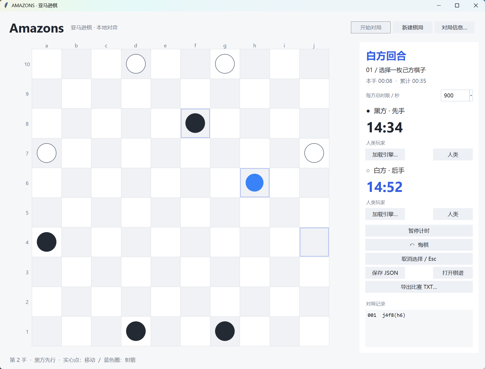
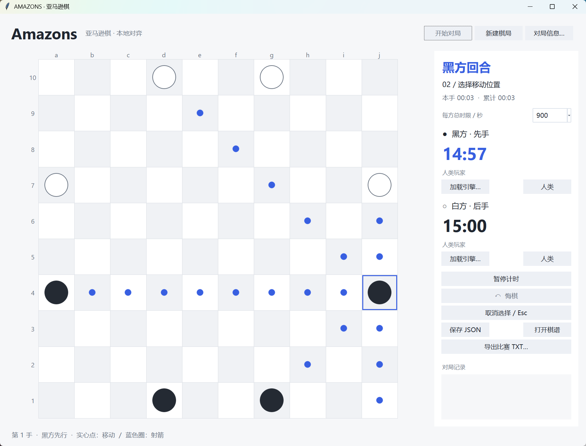
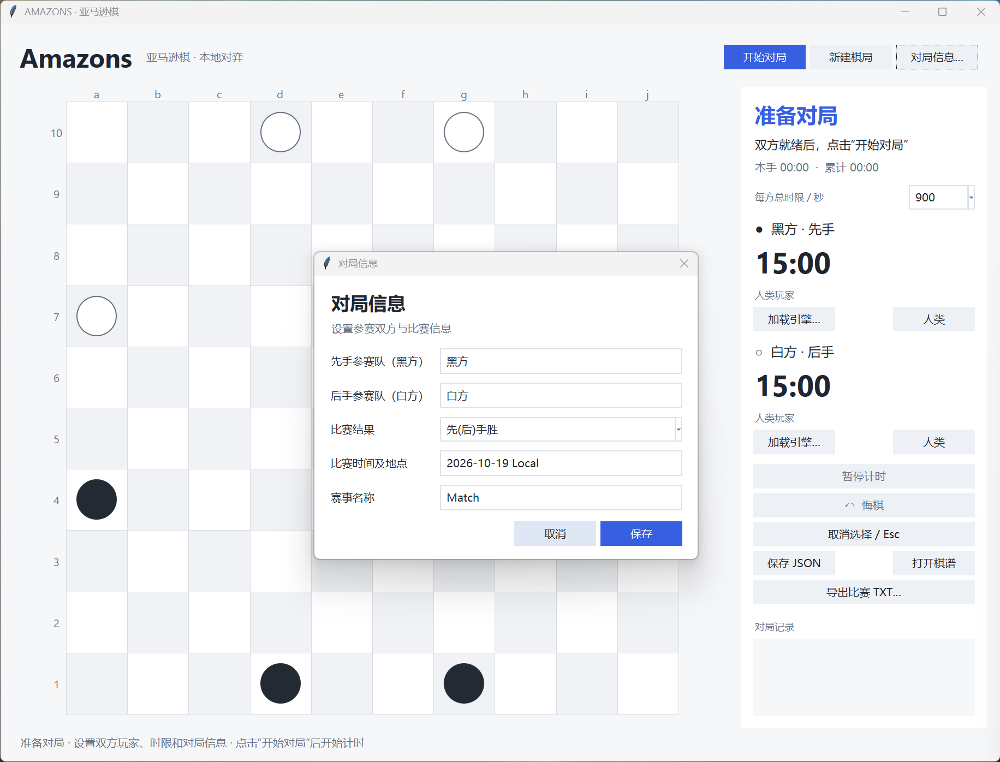

# Amazons Desktop

轻量的本地亚马逊棋桌面平台。支持双人、人机和双引擎对局，通过标准输入/输出接入独立引擎，无需依赖特定引擎仓库。



## 功能

- 10×10 棋盘，合法落点提示、圆形棋子和箭标记。
- 先准备、再手动开始；每方默认 900 秒，可选 100、300、750 秒或不限时。
- 后台加载引擎，显示名称和诊断；支持声明悔棋扩展的引擎。
- UTF-8 JSON 棋谱、GB2312 比赛 TXT 导出，以及两种格式的回放。
- 回放支持逐手、自动播放、进度跳转和从当前位置继续。

## 从源码运行

需要 Python 3.12 或更高版本及 Tk。Windows 的 Python 安装需包含 Tcl/Tk；其他系统需自行安装对应 Tk 软件包。Windows 是当前主要使用平台，其他系统尚未完成桌面体验验证。

```sh
python -m venv .venv
```

激活虚拟环境后，在仓库根目录执行：

```sh
python -m pip install -r requirements.txt
python desktop/launcher.py
```

也可使用 `make install` 和 `make run`。通过 `make PYTHON=完整路径 run` 指定解释器。

## 接入引擎与对局

1. 为双方选择“人类”或“加载引擎”，填写对局信息和时限。
2. 等待引擎完成名称握手，点击“开始对局”。
3. 人类依次点击己方棋子、移动落点、射箭位置；Esc 取消未完成的操作。
4. 保存 JSON，或填写比赛信息后导出 TXT。

选择引擎的目录初始为用户主目录，之后在当前程序会话内记住最近一次选择的目录。引擎以独立进程、无启动参数运行，工作目录为其所在目录；模型、动态库和运行环境由引擎提供。

接入方式、坐标、命令时序和可选悔棋扩展见 [通信协议](docs/protocol.md)。棋谱编码、字段及回放行为见 [棋谱说明](docs/records.md)。平台时限不会通过协议下发，引擎需自行配置搜索预算。

<details>
<summary>合法移动提示与对局信息</summary>





</details>

## 构建

```sh
python -m pip install -r requirements-build.txt
python tools/build.py
```

Windows 生成 `dist/AmazonsDesktop.exe`，打包 Python、Tk 和应用依赖；引擎及其模型另行提供。Windows 构建包含 PerMonitorV2 DPI 清单。PyInstaller 只构建当前系统的程序，不能跨系统打包。

在仓库根目录使用 Make：

| 命令 | 用途 |
| --- | --- |
| `make install` | 安装运行依赖 |
| `make install-build` | 安装构建依赖 |
| `make run` | 源码启动 |
| `make check` | 编译检查 Python 源码 |
| `make build` | 构建最新版程序 |
| `make clean` | 清理构建缓存，保留 dist 和 output |
| `make distclean` | 同时清理 dist，保留 output |

重复构建覆盖同名程序，构建或清理 dist 前先关闭正在运行的程序。无需 Make 时，直接使用上面的 Python 命令；清理入口为 `python tools/clean.py`。

## 代码结构

```text
src/amazons_desktop/
  __main__.py          启动与 Windows DPI 设置
  game.py              棋盘规则、走法与协议坐标
  clock.py             对局计时
  engine.py            引擎进程、管道与消息队列
  record.py            JSON / TXT 棋谱序列化
  ui/
    app.py             界面及对局状态协调
    board_view.py      棋盘与棋子绘制
    record_dialog.py   对局信息编辑
    theme.py           共享配色与控件主题
desktop/               源码启动入口及 Windows 清单
tools/                 构建与清理工具
tests/                 规则、桌面及真实引擎检查入口
docs/                  通信协议、棋谱说明及截图
Makefile               开发入口
```

规则、计时和棋谱模块不依赖界面。引擎读取线程只投递消息，由 Tk 主线程处理局面和界面更新。构建产物、虚拟环境和本地棋谱目录 `output/` 不入库。

目前未自动持久化玩家配置，未提供联网对弈、引擎启动参数编辑或搜索中悔棋。

## 许可证

[MIT](LICENSE)。
